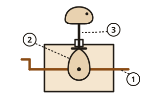

## Predict

A **cam** is a shaped wheel on an axle. A **follower** rests on top of it. As the cam turns, the follower rides up and down over its bumps.

1. **Axle**: turns when you turn the handle
2. **Cam**: the shaped wheel on the axle
3. **Follower**: the stick that rests on the cam and carries the animal

Talk with a partner:

- If the cam is a perfect circle with the axle in the middle, will the animal move? Why?
- For one turn of the handle, how many times will the animal go up with the egg-shaped cam?

## Run

1. Print the **cam parts** template (check the square measures 50 mm), or draw the parts using the measurements.
2. Glue the template onto card. Cut out the two cams, the follower foot, the animal and the handle. Make the holes.
3. Ask an adult to make a hole in each side of the box, opposite each other, about halfway up, and one hole in the middle of the top.
4. Push a skewer through one side of the box, through the **egg cam's** hole, and out the other side. Glue the cam in the middle of the skewer. Glue the handle to one end.
5. Cut a piece of straw 3 cm long and glue it over the top hole. This guides the follower.
6. Glue the **follower foot** to the bottom of the second skewer and the **animal** to the top. Drop it through the straw so the foot rests on the cam.
7. Turn the handle slowly and watch the animal.

## Investigate

1. Turn the handle **one** full turn. How many times does the animal go up and down?
2. Turn it slowly, then quickly. Does the animal go higher, or just faster?
3. Measure the **lift**: how far the animal rises from its lowest to its highest point, in millimetres.
4. Does the animal go up gently and drop suddenly, or the other way round? Which part of the cam causes this?

## Modify

1. Swap the egg cam for the **round cam** with the axle through its **off-centre** hole.
2. Predict first: will the movement be smoother or bumpier? Higher or lower?
3. Test it and fill in the table:

   | Cam | Lift (mm) | Ups per turn | Smooth or bumpy? |
   |---|---|---|---|
   | Egg cam | | | |
   | Round cam, off-centre hole | | | |

4. Draw a cam that would make the animal jump **twice** for every turn. What shape does it need?

## Make

Design your own cam toy: a frog that hops, a fish that bobs on waves, or a robot head that pops up. Design and cut your own cam shape to give the movement you want. Test it and change the cam until it works the way you planned.

## Teacher notes

- **Timing**: 10 min predict, 30 min build, 15 min investigate and modify, 5 min share. A ready-made box saves a lot of time.
- **Common problems**: follower gets stuck (straw too narrow, so use a wider straw or a rolled paper tube); cam slips on the axle (add tape around the skewer either side of the cam); animal doesn't come down (follower too light, so add a small ball of Prestik on top as weight).
- **Big idea**: a cam changes **rotary** motion into **reciprocating** (up-and-down) motion, like the crank in the rhino lesson, but the cam's **shape** decides exactly how it moves. Car engines and sewing machines use cams.
- **Maths link**: the lift of the egg cam equals its longest radius minus its shortest radius.
- **Extension (Grade 5)**: a double-bump cam (two lobes) makes two lifts per turn: ask learners to explain why.
