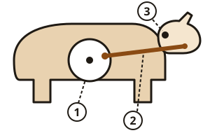

## Predict

A **crank** is a wheel with a pin near its edge. When the wheel turns, the pin goes round in a circle.

1. **Crank**: the disc on the axle, with the crank pin near its edge
2. **Push rod**: joins the crank pin to the head
3. **Pivot**: where the head is joined to the body

Talk with a partner:

- When you turn the handle round and round, what will the rhino's head do?
- Where have you seen a crank before? (Hint: think of a bicycle.)

## Run

1. Print the **rhino parts** template (check the square measures 50 mm), or draw the parts using the measurements.
2. Glue the template onto cardboard and cut out every part. Make all the holes with a pencil and Prestik.
3. Push a short piece of straw through the **middle hole** of the body. This is the bearing.
4. Push the skewer through the straw. Glue the **crank disc** onto one end of the skewer through its **centre hole**, and the **handle** onto the other end.
5. Join the **head** to the body: split pin through the hole at the back of the head and the hole near the top front of the body.
6. Join the **push rod**: one end to the **inner** crank pin hole (closest to the centre) with a split pin, the other end to the hole under the rhino's horn.
7. Turn the handle slowly and watch the head.

## Investigate

1. Turn the handle one full turn. How many times does the head go up and down?
2. Turn it slowly, then quickly. What changes, and what stays the same?
3. Use a ruler to measure how far the tip of the horn moves, from its lowest to its highest point, in millimetres.
4. Which parts go round in circles, and which parts go up and down?

## Modify

1. Move the push rod to the **outer** crank pin hole (further from the centre).
2. Predict first: will the head move more or less? Then measure how far the horn tip moves.
3. Fill in this table:

   | Crank pin hole | Distance from the centre (mm) | How far the horn moves (mm) |
   |---|---|---|
   | Inner | 8 | |
   | Outer | 14 | |

4. The crank pin moves up and down by **twice** its distance from the centre. Does your measurement show this?

## Make

Make another animal or a person that moves with a crank: a waving arm, a pecking bird or a fish that wags its tail. Draw it first and label the **crank**, **push rod** and **pivot**. Use the crank disc and push rod from the template, or design your own.

## Teacher notes

- **Timing**: 10 min predict, 30 min build, 15 min investigate and modify, 5 min share. Split over two lessons for Grade 3.
- **Common problems**: head jams at the top or bottom (push rod too long or too short for this rhino, so try the other crank hole or make the hole in the rod 5 mm further along); crank slips on the axle (glue not dry, so add tape around the axle where the disc sits); body bends (glue two layers of card together for the body).
- **Big idea**: a crank changes **rotary** (round-and-round) motion into **reciprocating** (up-and-down or back-and-forth) motion. Bicycle pedals, old sewing machines and car engines use cranks.
- **Maths link**: the head's movement is set by the crank pin's distance from the centre, and the pin moves through twice that distance from top to bottom.
- **Before this lesson**: learners should have built the rolling cart, so axles and bearings are familiar.
