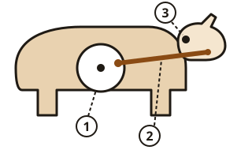

## Bikezela

I-**crank** yisondo elinesikhonkwane eduze komphetho walo. Uma isondo lizungeza, isikhonkwane sihamba sizungeza ngendilinga.

1. **I-crank**: idiski esekseli, enesikhonkwane se-crank eduze komphetho wayo
2. **Induku yokusunduza**: ixhuma isikhonkwane se-crank nekhanda
3. **Iphivothi**: lapho ikhanda lixhunywe khona nomzimba

Xoxa nomngane wakho:

- Uma uphendula isibambo uzungeza njalo, ikhanda likabhejane lizokwenzani?
- Uke wayibona kuphi i-crank ngaphambili? (Inkomba: cabanga ngebhayisikili.)

## Qalisa

1. Phrinta iphethini **yezingxenye zikabhejane** (hlola ukuthi isikwele silinganisa u-50 mm), noma udwebe izingxenye usebenzisa izilinganiso.
2. Namathisela iphethini ekhadibhodini bese usika zonke izingxenye. Bhoboza zonke izimbobo ngepensela ne-Prestik.
3. Faka ucezu olufushane lotshani embotsheni **ephakathi** yomzimba. Lena yibheringi.
4. Faka uthi lokosa otshanini. Namathisela **idiski ye-crank** ekugcineni okukodwa kothi ngembobo yayo **ephakathi**, bese unamathisela **isibambo** kolunye uhlangothi.
5. Xhuma **ikhanda** nomzimba: isikhonkwane sephepha sidlule embotsheni engemuva kwekhanda nasembotsheni eseduze nengaphambili eliphezulu lomzimba.
6. Xhuma **induku yokusunduza**: olunye uhlangothi lube **embotsheni yangaphakathi** yesikhonkwane se-crank (eseduze kakhulu nomaphakathi) ngesikhonkwane sephepha, olunye uhlangothi lube embotsheni engaphansi kophondo lukabhejane.
7. Phendula isibambo kancane bese ubuka ikhanda.

## Phenya

1. Phendula isibambo kube ukuzungeza okukodwa okuphelele. Ikhanda liya phezulu naphansi kangaki?
2. Liphendule kancane, bese ulisheshisa. Yini eshintshayo, futhi yini engashintshi?
3. Sebenzisa irula ukulinganisa ukuthi isihloko sophondo sihamba ibanga elingakanani, kusukela endaweni yaso ephansi kakhulu kuya kweyiphezulu kakhulu, ngamamilimitha.
4. Yiziphi izingxenye ezihamba zizungeza ngendilinga, futhi yiziphi ezihamba ziya phezulu naphansi?

## Shintsha

1. Hambisa induku yokusunduza uyiyise **embotsheni yangaphandle** yesikhonkwane se-crank (ekude nomaphakathi).
2. Bikezela kuqala: ingabe ikhanda lizonyakaza kakhulu noma kancane? Bese ulinganisa ukuthi isihloko sophondo sihamba ibanga elingakanani.
3. Gcwalisa leli thebula:

   | Imbobo yesikhonkwane se-crank | Ibanga ukusuka maphakathi (mm) | Uphondo luhamba ibanga elingakanani (mm) |
   |---|---|---|
   | Yangaphakathi | 8 | |
   | Yangaphandle | 14 | |

4. Isikhonkwane se-crank siya phezulu naphansi ngebanga eliphindwe **kabili** ibanga laso ukusuka maphakathi. Ingabe isilinganiso sakho siyakubonisa lokhu?

## Yenza

Yenza esinye isilwane noma umuntu onyakaza nge-crank: ingalo ephephezelayo, inyoni ecosha noma inhlanzi enyakazisa umsila wayo. Kudwebe kuqala bese ubhala amagama athi **i-crank**, **induku yokusunduza** kanye **nephivothi**. Sebenzisa idiski ye-crank nenduku yokusunduza ezisephethini, noma uklame ezakho.

## Amanothi kathisha

- **Isikhathi**: imizuzu eyi-10 yokubikezela, engama-30 yokwakha, eyi-15 yokuphenya nokushintsha, emi-5 yokwabelana. Hlukanisa izifundo ezimbili eBangeni 3.
- **Izinkinga ezivamile**: ikhanda liyabambeka phezulu noma phansi (induku yokusunduza yinde kakhulu noma imfushane kakhulu kulo bhejane, ngakho zama enye imbobo ye-crank noma wenze imbobo esendukwini ibe ngu-5 mm ngaphambili); i-crank iyashelela ku-ekseli (iglue ayikomi, ngakho songa itheyiphu ku-ekseli lapho idiski ihlala khona); umzimba uyagoba (namathisela izingqimba ezimbili zekhadi ndawonye zibe ngumzimba).
- **Umqondo omkhulu**: i-crank iguqula ukunyakaza **okuzungezayo** kube ukunyakaza **okuya emuva naphambili** (phezulu naphansi noma emuva naphambili). Amaphedali ebhayisikili, imishini yokuthunga yakudala nezinjini zezimoto zisebenzisa ama-crank.
- **Ukuxhumana nezibalo**: ukunyakaza kwekhanda kunqunywa yibanga lesikhonkwane se-crank ukusuka maphakathi, futhi isikhonkwane sihamba ibanga eliphindwe kabili lelo banga ukusuka phezulu kuya phansi.
- **Ngaphambi kwalesi sifundo**: abafundi kufanele ukuthi sebeyakhile inqola egingqikayo, ngakho ama-ekseli namabheringi sebewazi.
