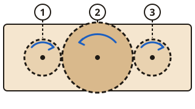

## Predict

**Gears** are wheels with **teeth**. When the teeth of two gears fit together, they **mesh**: turning one gear turns the other. Several gears in a row make a **gear train**. Robots use gear trains between their motors and wheels.

1. **Gear A**: 12 teeth, the one you turn
2. **Gear B**: 24 teeth
3. **Gear C**: 12 teeth

Talk with a partner:

- If you turn gear A clockwise, which way will gear B turn?
- Gear B has twice as many teeth as gear A. If you turn B once, how many times will A turn?

## Run

1. Print the **gear train** template (check the square measures 50 mm).
2. Glue the template onto thick card. Cut out the three gears carefully, tooth by tooth, and the board guide.
3. Draw an **arrow** on each gear from the centre to the edge, so you can count turns.
4. Lay the board guide on the base. Ask an adult to push a pencil through its three holes to mark the base, then make the three axle holes.
5. Cut three 4 cm pieces of skewer. Push one into each hole in the base so it stands up, and fix it underneath with tape or Prestik.
6. Put a short piece of straw on each skewer as a bearing, then gear A, B and C on the skewers in order. Check the teeth mesh.
7. Turn gear A slowly with your finger and watch all three gears.

## Investigate

1. Turn gear A **clockwise**. Which way does B turn? Which way does C turn?
2. Line up all the arrows. Turn gear B exactly **one** turn. How many times does gear A turn?
3. Turn gear A exactly one turn. How far does gear B turn?
4. Gear C is the same size as gear A. Does C turn faster, slower or the same as A? Why do you think B is called an **idler** here?

## Modify

1. Take gear C away. Now A drives B only. Fill in the table:

   | Driver gear (teeth) | Driven gear (teeth) | Turns of driver | Turns of driven |
   |---|---|---|---|
   | A (12) | B (24) | 2 | |
   | B (24) | A (12) | 1 | |

2. Write each one as a fraction: driver teeth ÷ driven teeth. What do you notice about the turns?
3. Predict: with a 36-tooth gear driving a 12-tooth gear, how many times would the small gear turn for each turn of the big one?

## Make

Design a gear train for a job: a fan that spins fast when you turn a handle slowly, a robot drive that turns a wheel slowly but strongly, or a toy where two figures turn in the same direction. Decide which gear you turn and what order the gears go in. Draw it, label the ratio, then build and test it.

## Teacher notes

- **Timing**: 10 min predict, 35 min build, 15 min investigate and share. Cutting gear teeth takes time: precut gears for younger groups, or work in pairs.
- **Common problems**: gears slip (teeth not meshing deeply enough, so check the axle holes match the board guide); gears wobble (add a second straw piece as a spacer); gears jam (a tooth is bent, so trim it).
- **Big idea**: meshing gears turn in opposite directions; the speed ratio equals the ratio of teeth. A big gear driving a small gear gives **speed**; a small gear driving a big gear gives **strength** (torque). An idler gear changes direction but not speed.
- **Robotics link**: robot motors spin very fast but weakly, so gear trains slow them down to give enough force to move wheels or arms. This prepares for the motor lesson and Phase 2.
- **Grade 7**: link to ratio and rate in Senior Phase Mathematics (to confirm against CAPS).
