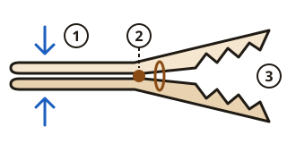

## Predict

Look at the two crocodile jaws on the template. They will be joined at **one point**, called the **pivot**.

1. **Effort**: where you squeeze (the handles)
2. **Pivot**: the point that does not move
3. **Load**: where the work is done (the teeth)

Talk with a partner:

- When you squeeze the handles together, what will the mouth do?
- What do you think the rubber band will do when you let go?
- Which part will **not** move when the jaws open and close?

## Run

1. Print the **crocodile jaws** template (check the square measures 50 mm), or draw the jaws using the measurements.
2. Glue the template onto thin cardboard and let it dry for a few minutes.
3. Cut out both jaws.
4. Make the three holes in each jaw with a pencil and a ball of Prestik.
5. Put the jaws on top of each other, teeth facing each other, and push the split pin through the **middle** holes of both jaws. Fold its legs flat.
6. Wrap the rubber band twice around the snout, just in front of the pivot.
7. Squeeze the handles together: the mouth opens. Let go: it snaps shut! Colour your crocodile.

## Investigate

1. Put your finger on the **pivot**. Does it move when the mouth opens?
2. Squeeze the handles a little, then a lot. How does the size of the mouth change?
3. Use a ruler to measure how wide the mouth opens, in centimetres, between the front teeth.
4. A clothes peg works the same way. Find its pivot, effort and load. Where is the pivot on a pair of scissors?

## Modify

1. Move the split pin to the hole **closest to the teeth**. Measure how wide the mouth opens now.
2. Move it to the hole **closest to the handles** and measure again.
3. Copy this table and fill it in:

   | Pivot hole | How wide the mouth opens (cm) | Easy or hard to squeeze? |
   |---|---|---|
   | Near the teeth | | |
   | Middle | | |
   | Near the handles | | |

4. Which hole gives the biggest bite? Which is easiest to squeeze?

## Make

Design your own snapping animal: a bird's beak, a shark or a dinosaur. It must use **one pivot**. Draw your design first, label the **pivot**, **effort** and **load**, then build it. Show a partner how it works.

## Teacher notes

- **Timing**: 5 min predict, 20 min build, 10 min investigate and modify, 5 min share. "Make" can be homework.
- **Common problems**: jaws won't move (split pin folded too tightly, so loosen it); mouth won't snap shut (rubber band too loose, so wrap it once more); jaws flop (holes too big, so use the next hole along or put tape over the hole and remake it).
- **No split pins?** Push a short piece of straw through both holes and tie a knot of string on each side.
- **Big idea**: a lever lets a small movement in one place make a bigger (or stronger) movement somewhere else. Moving the pivot changes the trade-off between *how far* and *how strong*.
- **Extension (Grade 4)**: ask learners to predict, before measuring, which hole makes the widest mouth, then compare with their table.
