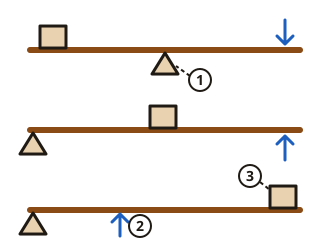

## Predict

Every lever has three parts: the **fulcrum** (pivot), the **effort** (where you push or pull) and the **load** (what moves). The **order** of these three decides the type of lever.

1. **Fulcrum**: the pivot the lever turns on
2. **Effort**: where the push or pull goes
3. **Load**: what is being moved

Talk with a partner:

- On a seesaw, can a small child lift a bigger child? Where would each have to sit?
- Your forearm is a lever. Where is the fulcrum, where is the effort (your muscle) and where is the load (what's in your hand)?

## Run

**Part A: lever bench**

1. Print the **lever bench** template. Glue it onto two layers of card for strength and cut out the beam and the stand.
2. Fold the stand into a triangle along the dashed lines and tape it. The top edge is the fulcrum.
3. The dashed lines on the beam are marks, not folds: number them 4 3 2 1 0 1 2 3 4. Balance the beam on the stand at mark 0. Adjust until it balances level.

**Part B: robot arm**

4. Print the **robot arm** template and cut out the base, the tower and the arm.
5. Fold the base and tower along the dashed lines and tape the tower upright onto the base.
6. Join the arm to the top of the tower with a split pin through the **pivot** hole, so it swings up and down.
7. Tie a 30 cm string to the **first effort** hole, the one nearest the pivot. The string is the robot's muscle.
8. Bend a paper clip into a hook and hang it from the **gripper** hole at the far end of the arm.
9. Hold the base down and pull the string straight up: the arm lifts the hook. Try lifting a paper-clip "load".

## Investigate

1. On the lever bench, put **2 coins** on mark 4 on the left. Where on the right do 2 coins balance? Where do 4 coins balance? 1 coin?
2. Copy and fill in the table. Multiply coins by distance on each side. What do you notice?

   | Left: coins × mark | Right: coins × mark | Balanced? |
   |---|---|---|
   | 2 × 4 = 8 | 2 × ___ | |
   | 2 × 4 = 8 | 4 × ___ | |
   | 2 × 4 = 8 | 1 × ___ | |

3. Which type of lever is the bench? Which type is your robot arm?
4. On the robot arm, is it easier or harder to lift the load than to lift it with your hand? Does the load move further or less than the string?

## Modify

1. Move the string to the **second** effort hole, further from the pivot. Pull to lift the same load.
2. Is it easier to pull now? Does the gripper move as far for the same pull?
3. Use the balancing rule to predict: where should you put **3 coins** on the bench to balance **6 coins** on mark 2? Test it.

## Make

Industrial robots in car factories have arms with several joints. Design a robot arm with **two** joints (shoulder and elbow) that can pick up a paper cup with a paper-clip handle and put it down somewhere else. Label each lever and its type. Build it, test it and improve it.

## Teacher notes

- **Timing**: 90 minutes, best as two 45-minute lessons (Part A then Part B).
- **Common problems**: beam won't balance empty (the two layers of card aren't even, so add a small piece of tape on the light side); arm drops back too fast (split pin too loose, so tighten slightly); tower bends (glue a second layer of card inside, or use a small box as the tower).
- **Big idea**: coins × distance from the fulcrum on one side equals coins × distance on the other side when a lever balances. This is why a long lever lets a small effort move a big load, and why robot arms need strong motors near their shoulders.
- **The three types**: type 1 (fulcrum in the middle: seesaw, scissors), type 2 (load in the middle: wheelbarrow, bottle opener), type 3 (effort in the middle: tweezers, your forearm, most robot arms).
- **Extension (Grade 6)**: write the balancing rule as a sentence and as a number pattern, then test one prediction of their own.
