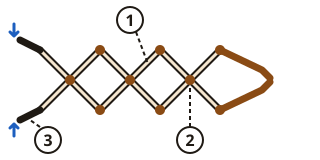

## Predict

A **linkage** is a set of bars (called **links**) joined at **pivots** so that when one moves, they all move. Robots use **grippers** to pick things up, and this grabber is a gripper you can build.

1. **Links**: the cardboard bars
2. **Pivot**: where two links cross or join
3. **Handles**: where you push

Talk with a partner:

- If you move the handles 2 cm closer together, will the claws move **less**, **the same** or **more** than 2 cm?
- Where have you seen a machine like this? (Hint: some baby gates, lamps and toy grabbers.)

## Run

1. Print the **grabber parts** template (check the square measures 50 mm), or draw the parts using the measurements.
2. Glue the template onto cardboard. Cut out the 6 links and the 2 claws. Make every hole with a pencil and Prestik.
3. Make an **X**: cross two links and join them through their **middle** holes with a split pin. Make three X's.
4. Join the X's in a row: the end holes of one X join the end holes of the next X, top to top and bottom to bottom.
5. Join a **claw** to each of the two end holes at the front.
6. The two loose ends at the back are the handles. Push them together and pull them apart.
7. Try to pick up a crumpled piece of paper from across the table.

## Investigate

1. Count the links and the pivots. How many of each are there?
2. Put the grabber on the table next to a ruler. Move the handles 2 cm closer together. How far forward do the claws move?
3. Is that **more** or **less** than 2 cm? About how many times more?
4. What happens if one split pin is very tight? Why do all the joints need to turn easily?

## Modify

1. Take one X off so your grabber has only **two** X's. Move the handles 2 cm again and measure.
2. Fill in this table:

   | Number of X's | Handles move (cm) | Claws move (cm) |
   |---|---|---|
   | 3 | 2 | |
   | 2 | 2 | |

3. What do you notice? Predict how far the claws would move with **4** X's, then test your prediction if you have time.

## Make

Design a grabber for a job: picking up litter, reaching a book on a high shelf, or a robot gripper that picks up a bottle cap. Decide how many X's it needs and what shape the claws should be. Draw your design, label a **link**, a **pivot** and the **gripper**, then build and test it.

## Teacher notes

- **Timing**: 10 min predict, 30 min build, 15 min investigate and modify, 5 min share.
- **Common problems**: grabber twists sideways (all split pins must point the same way, so check every joint goes top-to-top); hard to move (a split pin is too tight, so loosen it); claws don't meet (join each claw to the end hole, not the middle hole).
- **Big idea**: each X multiplies the movement. More X's means the claws move further but grip with less force: a trade-off, like the crocodile's pivot holes.
- **Robotics link**: industrial and service robots use grippers; this one is moved by hand, while a robot's gripper is moved by a motor or actuator.
- **Extension (Grade 5)**: measure for 1, 2 and 3 X's and look for a pattern in the table.
