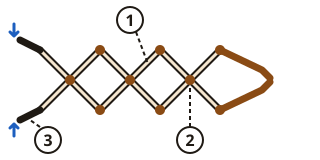

## Bikezela

**Isixhumanisi** yiqoqo lezinti (ezibizwa ngokuthi **izinti zokuxhuma**) ezixhunywe **kumaphivothi** ukuze lapho enye inyakaza, zonke zinyakaze. Amarobhothi asebenzisa **izibambi** ukucosha izinto, futhi lesi sibambi siyisibambi ongazakhela sona.

1. **Izinti zokuxhuma**: izinti zekhadibhodi
2. **Iphivothi**: lapho izinti ezimbili ziphambana khona noma zihlangana khona
3. **Izibambo**: lapho ucindezela khona

Xoxa nomngane wakho:

- Uma usondeza izibambo ngo-2 cm, ingabe izinzipho zizohamba ibanga **elincane**, **elifanayo** noma **elide** kuno-2 cm?
- Uke wawubona kuphi umshini onjengalona? (Inkomba: amanye amasango ezingane, amalambu nezibambi zamathoyizi.)

## Qalisa

1. Phrinta iphethini **yezingxenye zesibambi** (hlola ukuthi isikwele silinganisa u-50 mm), noma udwebe izingxenye usebenzisa izilinganiso.
2. Namathisela iphethini ekhadibhodini. Sika izinti zokuxhuma ezi-6 nezinzipho ezi-2. Bhoboza zonke izimbobo ngepensela ne-Prestik.
3. Yenza u-**X**: phambanisa izinti zokuxhuma ezimbili bese uzixhuma ngezimbobo zazo **ezimaphakathi** ngesikhonkwane sephepha. Yenza ama-X amathathu.
4. Xhuma ama-X alandelane: izimbobo zasekugcineni zika-X oyedwa zixhumana nezimbobo zasekugcineni zika-X olandelayo, phezulu nophezulu, phansi nophansi.
5. Xhuma **uzipho** embotsheni ngayinye yasekugcineni ezimbili ngaphambili.
6. Iziphetho ezimbili ezikhululekile ngemuva yizibambo. Zisondeze ndawonye bese uzihlukanisa.
7. Zama ukucosha iphepha eligoqoziwe ngaphesheya kwetafula.

## Phenya

1. Bala izinti zokuxhuma namaphivothi. Kukhona okungakanani kwakho kokubili?
2. Beka isibambi etafuleni eduze kwerula. Sondeza izibambo ngo-2 cm. Izinzipho zihamba ibanga elingakanani ziya phambili?
3. Ingabe lokho **kungaphezu** noma **kungaphansi** kuka-2 cm? Kuphindwe kangaki cishe?
4. Kwenzekani uma isikhonkwane sephepha esisodwa siqinile kakhulu? Kungani wonke amalunga kufanele azungeze kalula?

## Shintsha

1. Khipha u-X oyedwa ukuze isibambi sakho sibe nama-X **amabili** kuphela. Hambisa izibambo ngo-2 cm futhi bese ulinganisa.
2. Gcwalisa leli thebula:

   | Inani lama-X | Izibambo zihamba (cm) | Izinzipho zihamba (cm) |
   |---|---|---|
   | 3 | 2 | |
   | 2 | 2 | |

3. Ubonani? Bikezela ukuthi izinzipho bezingahamba ibanga elingakanani nama-X angu-**4**, bese uhlola ukubikezela kwakho uma unesikhathi.

## Yenza

Klama isibambi somsebenzi othile: ukucosha udoti, ukufinyelela incwadi eshalofini eliphezulu, noma isibambi serobhothi esicosha isivalo sebhodlela. Nquma ukuthi sidinga ama-X amangaki nokuthi izinzipho kufanele zibe nasiphi isimo. Dweba umklamo wakho, ubhale **uthi lokuxhuma**, **iphivothi** kanye **nesibambi**, bese uyasakha futhi usihlole.

## Amanothi kathisha

- **Isikhathi**: imizuzu eyi-10 yokubikezela, engama-30 yokwakha, eyi-15 yokuphenya nokushintsha, emi-5 yokwabelana.
- **Izinkinga ezivamile**: isibambi siyasonteka siye eceleni (zonke izikhonkwane zephepha kumele zibheke ngendlela efanayo, ngakho hlola ukuthi ilunga ngalinye lixhuma phezulu nophezulu); kunzima ukusinyakazisa (isikhonkwane sephepha siqinile kakhulu, ngakho sixegise); izinzipho azihlangani (xhuma uzipho ngalunye embotsheni yasekugcineni, hhayi embotsheni ephakathi).
- **Umqondo omkhulu**: u-X ngamunye uphindaphinda ukunyakaza. Ama-X amaningi asho ukuthi izinzipho zihamba ibanga elide kodwa zibamba ngamandla amancane: kuyakhethwa, njengasezimbotsheni zephivothi zengwenya.
- **Ukuxhumana namarobhothi**: amarobhothi asezimbonini nawokusiza asebenzisa izibambi; lesi sinyakaziswa ngesandla, kanti isibambi serobhothi sinyakaziswa yinjini noma i-actuator.
- **Okwengeziwe (iBanga 5)**: linganisa nge-X elilodwa, amabili namathathu bese ubheka iphethini ethebuleni.
