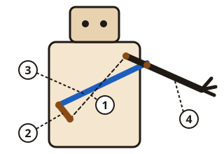

## Predict

A **four-bar linkage** has four links joined in a loop. One link is **fixed** (it doesn't move). One link turns all the way round: the **crank**. One link only swings back and forth: the **rocker**. The **coupler** joins the crank to the rocker.

1. **Fixed link**: the body, between the two pivot holes
2. **Crank**: turns all the way round
3. **Coupler**: joins the crank to the arm
4. **Rocker**: the arm that waves

Talk with a partner:

- The crank turns all the way round. Will the arm turn all the way round too? Why not?
- Where in your body is there a link that swings back and forth?

## Run

1. Print the **waving robot** template (check the square measures 50 mm), or draw the parts using the measurements.
2. Glue the template onto cardboard. Cut out the body, the crank, the coupler, the arm and the hand. Make every hole with a pencil and Prestik.
3. Join the **crank** to the body's **lower** pivot hole with a split pin. Join the **arm** to the body's **shoulder** hole through the arm's **first** hole.
4. Join one end of the **coupler** to the crank's outer hole, and the other end to the arm's **middle** hole.
5. Glue the **hand** onto the end of the arm.
6. Hold the body flat on the table and turn the crank all the way round, slowly.

## Investigate

1. Turn the crank one full turn. How many times does the arm wave up and back?
2. Hold a protractor at the shoulder. Measure the arm's lowest and highest angles. How many degrees does it swing through?
3. Watch the coupler. Does it turn all the way round, or does it wobble?
4. Is there a point where the crank gets stuck? Where are the links when this happens?

## Modify

1. Make a **longer crank** (cut a strip 55 mm long with holes 40 mm apart). Predict: will the arm swing more or less?
2. Test it. Does the crank still go all the way round?
3. Fill in the table:

   | Crank (hole to hole) | Arm swings (degrees) | Crank turns all the way? |
   |---|---|---|
   | 30 mm | | |
   | 40 mm | | |

4. What do you think will happen with a crank that is **too** long? Test it with a 60 mm crank if you have time.

## Make

Design a robot or animal that copies a real movement using a four-bar linkage: a bird flapping a wing, a person rowing a boat, or a robot saluting. Decide which link is fixed, which is the crank and which is the rocker. Draw and label your design, build it, and change the link lengths until the movement looks right.

## Teacher notes

- **Timing**: 10 min predict, 30 min build, 15 min investigate and modify, 5 min share.
- **Common problems**: crank jams (a split pin is too tight, or the coupler is joined to the wrong arm hole); arm swings too little (check the coupler joins the arm's middle hole, not the end); parts twist (keep all the links on the same side of the body).
- **Big idea**: in a crank-rocker four-bar linkage, the shortest link plus the longest link must be shorter than the other two added together, otherwise the crank can't go all the way round. Here: 30 + 90 is less than 80 + 60. A 60 mm crank breaks the rule: learners discover it jams.
- **Real world**: windscreen wipers, bicycle pedalling legs and many robot grippers are four-bar linkages. This links to the crank in the rhino lesson and prepares for motor-driven robots in Phase 2.
- **Paper protractor**: if there are no protractors, fold a paper circle in half, then in half again, then once more, to mark 45° steps.
