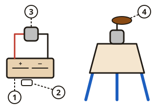

## Predict

A **motor** is an **actuator**: it turns electrical energy into movement. A motor only runs when it is part of a **complete circuit**: battery, wires, switch and motor all joined in a loop.

1. **Battery holder** with 2 AA batteries: the power source
2. **Switch**: opens and closes the circuit
3. **Motor**: the actuator
4. **Off-centre weight**: makes the motor shake

Talk with a partner:

- What will happen if one wire is not joined to the motor?
- A washing machine shakes when the clothes are all on one side. How might a spinning motor with a weight on one side make a robot move?

## Run

1. Print the **scribble bot** template and glue it onto card. Cut out the weight discs and the cup band.
2. Glue the three **weight discs** on top of each other, lining up the holes. This makes a thick weight.
3. Ask an adult to fix the two wires from the battery holder to the two tabs on the motor (twist them through the holes and tape them).
4. Check the switch is **off**. Put the batteries into the holder the right way round (match + and −).
5. Push the weight onto the motor shaft through the **off-centre** hole. Add a small ball of Prestik on the weight's far edge to make it heavier.
6. Turn the cup upside down. Tape the motor on top and the battery holder to the side.
7. Tape three markers around the cup as **legs**, caps off and tips down, so the cup stands on them.
8. Put the robot on a big sheet of paper, switch it on and watch it draw. Switch it off to stop.

## Investigate

1. Draw the circuit as a picture. Follow the path the electricity takes around the loop.
2. Switch on with the weight pushed on through its **centre** hole instead. What happens? Why?
3. Look at the drawing. Is it circles, lines or scribbles? Does the robot go round in one direction?
4. Swap the two wires on the motor. What changes about the spin and the drawing?

## Modify

Change **one** thing at a time and record what happens:

   | Change | Prediction | What the drawing looked like |
   |---|---|---|
   | Bigger ball of Prestik on the weight | | |
   | Legs spread wider apart | | |
   | One leg shorter than the others | | |
   | Motor moved to the edge of the cup | | |

Which change made the biggest difference? Why do you think so?

## Make

Design a scribble robot that draws a pattern on purpose: big loops for a poster, or small spirals for a greeting card. Decide on the weight, the legs and where the motor goes. Draw your design and the circuit, build it, and test and improve it until it draws the pattern you planned.

## Teacher notes

- **Timing**: 10 min predict, 30 min build, 15 min investigate and modify, 5 min share. Prepare the motor wires before the lesson if possible.
- **Electrical safety**: this lesson uses 2 AA batteries (3 V) only. Check every battery holder before the lesson; remove batteries afterwards so they don't drain. Never use coin or button cells, never mains. If a motor stops and gets hot, it has jammed: switch off.
- **Common problems**: motor doesn't spin (switch off, a loose wire, or a battery the wrong way round: check the circuit loop); robot falls over (weight too heavy, or legs too close together); robot moves but doesn't draw (marker caps on, or legs not touching the paper).
- **Big idea**: energy goes from the battery (stored chemical energy) to the wires (electrical) to the motor (movement) and the noise and heat. The unbalanced weight turns spinning into shaking, the same way a phone vibrates.
- **Bridge to Phase 2**: in M3 this motor is switched on, off and reversed by a micro:bit instead of a hand switch. Keep the motors and battery holders for those lessons.
