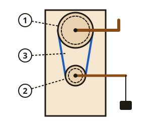

## Predict

A **pulley** is a wheel with a groove around its edge. A **belt** (here, a rubber band) loops around two pulleys. Turning the **drive pulley** pulls the belt, and the belt turns the **driven pulley**.

1. **Big pulley**: on the top axle, with a handle
2. **Small pulley**: on the lower axle, which also winds the string
3. **Belt**: the rubber band

Talk with a partner:

- When you turn the big pulley once, will the small pulley turn **less**, **the same** or **more** than once?
- Do the two pulleys turn the **same** way or **opposite** ways? (Think about the gears lesson.)

## Run

1. Print the **pulley parts** template and glue it onto card. Cut out all the discs and both handles. Make the centre holes.
2. Make each pulley: glue a **core** between its two **flanges**, lining up the holes. Let the glue dry.
3. Ask an adult to make two pairs of holes straight across the box: one pair near the top, one pair about 12 cm lower.
4. Push a skewer through the top holes with the **big** pulley on it, and a skewer through the lower holes with the **small** pulley on it. Glue each pulley to its skewer.
5. Glue a **handle** onto the end of each skewer, outside the box. Push a short piece of skewer into the outer hole of each handle as a grip.
6. Stretch a rubber band around both pulleys, in the grooves.
7. Tape one end of the string to the lower skewer, and tie the load to the other end so it hangs down.
8. Turn the **top** handle and watch the load go up.

## Investigate

1. Draw a mark on each pulley. Turn the big pulley exactly **one** turn. How many times does the small pulley turn?
2. Do the pulleys turn the same way or opposite ways? How is that different from two gears?
3. Time how long it takes to lift the load to the top using the top handle.
4. How hard is it to turn? Try holding the load still with one finger while someone turns.

## Modify

1. Move the string and load to the **top** skewer. Now turn the **lower** handle, so the small pulley drives the big one.
2. Fill in the table:

   | You turn | Load is on | Time to lift (seconds) | Easy or hard to turn? |
   |---|---|---|---|
   | Big pulley | Small pulley axle | | |
   | Small pulley | Big pulley axle | | |

3. Which setup lifts **faster**? Which lifts more **easily**? Why can't you have both?
4. Twist the rubber band into a figure 8 and turn the handle. What changes?

## Make

Design a pulley machine for a job: a lift that raises a toy bucket out of a well, a flag that rises up a pole, or a conveyor belt that moves a bottle cap along a box. Decide which pulley you turn and which pulley does the work. Draw and label your design, build it, and improve it until it works smoothly.

## Teacher notes

- **Timing**: 10 min predict, 35 min build (glue must dry), 15 min investigate and share. Making the pulleys in a previous lesson saves time.
- **Common problems**: belt slips (rubber band too loose, so use a smaller band or move the axles further apart); belt jumps off (flanges too small or glued crooked); axle turns but pulley doesn't (re-glue the pulley to the skewer, or wrap tape around the skewer first so it fits tightly).
- **Big idea**: a belt turns both pulleys the same way (a crossed belt reverses them). Big driving small = more speed, less force; small driving big = less speed, more force. It's the same trade-off as gears, but a belt can slip, which is safer if something jams.
- **Real world**: car engine fan belts, bicycle chains (a toothed belt), conveyor belts and the drives inside 3D printers and robot arms.
- **Grade 7**: compare the pulley ratio (56 ÷ 28) with the turns counted; link to ratio in Senior Phase Mathematics (to confirm against CAPS).
