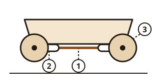

## Predict

About 5,500 years ago, people discovered that a heavy load is much easier to move on **wheels**. Before that, they dragged loads or rolled them on logs.

1. **Axle**: the stick the wheels turn on
2. **Straw**: holds the axle under the cart and lets it spin
3. **Wheel**

Talk with a partner:

- Will a box move more easily if you **push** it along the floor or put it on **wheels**? Why?
- Which part should spin: the wheel, the axle, or both?

## Run

1. Print the **cart parts** template (check the square measures 50 mm), or draw the parts using the measurements.
2. Glue the template onto cardboard. Cut out the cart body and the four wheels.
3. Fold the cart body along the dashed lines to make a tray, and tape the corners.
4. Make a hole in the centre of each wheel with a pencil and a ball of Prestik.
5. Cut two straws the same width as the cart and tape them across the bottom, one near each end.
6. Push a skewer through each straw. Push a wheel onto each end of each skewer, then a small ball of Prestik on the outside so the wheel can't fall off.
7. Give your cart a gentle push. Does it roll in a straight line?

## Investigate

1. Make a ramp: lean a book or a flat board on a pile of two books.
2. Let your cart roll down the ramp **without pushing it**. Measure how far it rolls from the bottom of the ramp, in centimetres.
3. Do it three times. Why is it better to test more than once?
4. Now take the wheels off and slide the cart down the ramp. How far does it go? What slows it down? (This force is called **friction**.)

## Modify

Change **one thing at a time** and test again. Keep everything else the same so the test is fair.

| What I changed | Distance 1 (cm) | Distance 2 (cm) | Distance 3 (cm) |
|---|---|---|---|
| Nothing (my first cart) | | | |
| Put a rubber band around each wheel as a tyre | | | |
| Put 5 coins in the cart | | | |
| Made the ramp higher | | | |

Which change made the biggest difference? Why do you think so?

## Make

Design a cart that carries **10 coins** as far as possible down the ramp. You may change the wheels, the axles or the cart, but you must use the same ramp. Measure your best distance and explain your design to the class.

## Teacher notes

- **Timing**: 5 min predict, 25 min build, 15 min investigate and modify, 5 min share. "Make" works well as a class competition.
- **Common problems**: cart doesn't roll (straws not parallel, so re-tape them square to the edge; wheels rubbing on the cart, so slide them outwards a little); wobbly wheels (hole too big, so add Prestik on both sides of the wheel).
- **Fair test**: the key science skill here is keeping everything the same except one change. Ask "what did you keep the same?"
- **History link**: the earliest known wheels were used in Mesopotamia (today's Iraq) for pottery and carts; wheels changed farming, trade and travel.
- **Extension (Grade 4)**: calculate the average of the three distances.
