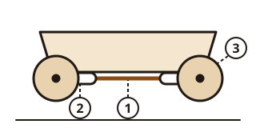

## Bikezela

Eminyakeni engaba ngu-5 500 edlule, abantu bathola ukuthi umthwalo osindayo kulula kakhulu ukuwuhambisa uma usemasondweni. Ngaphambi kwalokho, babedonsa imithwalo noma bayigingqe phezu kwezingodo.

1. **I-ekseli**: induku amasondo azungeza kuyo
2. **Utshani**: bubamba i-ekseli ngaphansi kwenqola futhi buyivumela izungeze
3. **Isondo**

Xoxa nomngane wakho:

- Ingabe ibhokisi lizohamba kalula uma ulisunduza phansi, noma uma ulibeka **emasondweni**? Kungani?
- Iyiphi ingxenye okufanele izungeze: isondo, i-ekseli, noma kokubili?

## Qalisa

1. Phrinta iphethini **yezingxenye zenqola** (hlola ukuthi isikwele silinganisa u-50 mm), noma udwebe izingxenye usebenzisa izilinganiso.
2. Namathisela iphethini ekhadibhodini. Sika umzimba wenqola namasondo amane.
3. Goqa umzimba wenqola emigqeni enamachashazi ukuze wenze ithreyi, bese unamathisela amakhona ngetheyiphu.
4. Bhoboza imbobo maphakathi nesondo ngalinye ngepensela nebhola le-Prestik.
5. Sika izingcezu ezimbili zotshani ezilingana nobubanzi benqola bese uzinamathisela ngaphansi kwayo, esinye eduze nohlangothi ngalunye.
6. Faka uthi lokosa otshanini ngabunye. Faka isondo ekugcineni ngakunye kothi ngalunye, bese ufaka ibhola elincane le-Prestik ngaphandle ukuze isondo lingaphumi.
7. Sunduza inqola yakho kancane. Ingabe igingqika iqonde ngqo?

## Phenya

1. Yenza umthambeka: encika incwadi noma ibhodi eliyisicaba enqwabeni yezincwadi ezimbili.
2. Yeka inqola yakho igingqike yehle emthambekeni **ungayisunduzi**. Linganisa ngamasentimitha ukuthi igingqika ibanga elingakanani kusukela ezansi komthambeka.
3. Kwenze kathathu. Kungani kungcono ukuhlola kaningi?
4. Manje khipha amasondo bese ushelelisa inqola yehle emthambekeni. Ihamba ibanga elingakanani? Yini eyinciphisa ijubane? (La mandla abizwa ngokuthi **ukuhuzuka**.)

## Shintsha

Shintsha **into eyodwa ngesikhathi** bese uhlola futhi. Gcina konke okunye kunjalo ukuze ukuhlola kube kulungile.

| Engikushintshile | Ibanga 1 (cm) | Ibanga 2 (cm) | Ibanga 3 (cm) |
|---|---|---|---|
| Lutho (inqola yami yokuqala) | | | |
| Ngifake irabha ezungeze isondo ngalinye njengethayi | | | |
| Ngifake izinhlamvu zemali ezi-5 enqoleni | | | |
| Ngenze umthambeka waba phezulu | | | |

Yiluphi ushintsho olwenze umehluko omkhulu kakhulu? Ucabanga ukuthi kungani?

## Yenza

Klama inqola ethwala **izinhlamvu zemali eziyi-10** iye kude ngangokunokwenzeka yehla emthambekeni. Ungashintsha amasondo, ama-ekseli noma inqola, kodwa kumele usebenzise umthambeka ofanayo. Linganisa ibanga lakho elihle kakhulu bese uchazela ikilasi umklamo wakho.

## Amanothi kathisha

- **Isikhathi**: imizuzu emi-5 yokubikezela, engama-25 yokwakha, eyi-15 yokuphenya nokushintsha, emi-5 yokwabelana. Isinyathelo esithi "Yenza" sisebenza kahle njengomncintiswano wekilasi.
- **Izinkinga ezivamile**: inqola ayigingqiki (utshani abuhambisani, ngakho buphinde ubunamathisele buqonde nomphetho; amasondo ahuzuka enqoleni, ngakho wasunduzele ngaphandle kancane); amasondo azamazamayo (imbobo inkulu kakhulu, ngakho engeza i-Prestik nhlangothi zombili zesondo).
- **Ukuhlola okulungile**: ikhono elibalulekile lesayensi lapha ukugcina konke kunjalo ngaphandle koshintsho olulodwa. Buza ukuthi "yini oyigcine ifana?"
- **Ukuxhumana nomlando**: amasondo akudala kunawo wonke aziwayo ayesetshenziswa eMesopotamiya (i-Iraq yanamuhla) ekwenzeni izitsha zobumba nasezinqoleni; amasondo ashintsha ukulima, ukuhweba nokuhamba.
- **Okwengeziwe (iBanga 4)**: bala isilinganiso samabanga amathathu.
