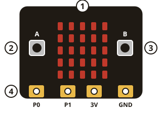

## Predict

A robot has three main parts: **sensors** (inputs), a **controller** that decides what to do, and **outputs** such as lights and motors. On the micro:bit, the buttons are inputs, the micro:bit itself is the controller and the LED display is an output.

1. **LED display**: output
2. **Button A**: input
3. **Button B**: input
4. **Pins**

Open the starter program and read the three blocks. Each one waits for something to happen: this is called an **event**.

Talk with a partner:

- What face will you see before you press anything?
- What will happen when you press A? And B?
- What will happen if you press A and B at the same time?

## Run

1. Tap **Run**. Press **A**, then **B**, on the on-screen micro:bit (tap the buttons, or use the keyboard).
2. Try pressing both at once. Was your prediction right?
3. If you have a real micro:bit, send the program to it and test it the same way.

## Investigate

1. Which block runs only once, when the program starts? How do you know?
2. Swap the faces in the A and B blocks. Run it. What changed and what stayed the same?
3. Look at the Python tab. Which line checks if button A was pressed?
4. Fill in this table for the starter program:

   | Input | Output |
   |---|---|
   | Program starts | |
   | Button A pressed | |
   | Button B pressed | |

## Modify

1. Add an **on shake** block (in **Input**) that shows a surprised face. Test it with the **Shake** button under the on-screen micro:bit.
2. Make button A show a face and then, after a pause, go back to the sleepy face.
3. Make button B **clear** the screen instead of showing a sad face.

## Make

Make a **feelings meter** or a **yes/no voting machine** for your class. First fill in an input and output table for your idea. Then build it, test every row of your table, and fix anything that doesn't match. Show a partner, and let them try it without telling them which button does what. Could they work it out?

## Teacher notes

- **Timing**: 10 min predict, 10 min run and investigate, 10 min modify, 15 min make and share.
- **Big idea**: an **event** is something that happens (a button press); the program **reacts** to it. This is how robots respond to the world.
- **Planning tables** of inputs and outputs are a good habit before coding and a simple assessment tool.
- **Common problems**: on the on-screen micro:bit, tap Run first, then the buttons; on a real micro:bit, press the reset button on the back to restart the program.
