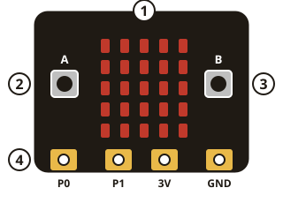

## Predict

A **micro:bit** is a tiny computer. It follows a **program**: a list of instructions, one after the other. The 25 red lights on its front are **LEDs**. They are an **output**: the micro:bit uses them to show us something.

1. **LED display**: 25 small lights
2. **Button A**
3. **Button B**
4. **Pins**: places to join wires (we use them in the motor lessons)

Tap **Open the starter program in the code editor** (near the end of this page, before the syllabus links). Look at the blocks, then tap the **Python** tab to see the same program written as text. Don't run it yet.

Talk with a partner:

- What will the micro:bit show first? What comes next?
- How long will the heart stay on? (1000 milliseconds = 1 second)
- When will the program stop?

## Run

1. Tap **Run** under the on-screen micro:bit. Was your prediction right?
2. If you have a real micro:bit, plug it in with the USB cable and tap **Send to micro:bit** (or **Download .hex** and copy the file onto the MICROBIT drive).
3. Watch the real micro:bit. Does it do the same as the on-screen one?

## Investigate

1. Take the **clear screen** block out of the program and run it again. What changes? Why?
2. Which block makes the program go back to the start? What is its name?
3. Count how many times the heart blinks in 10 seconds. Use the pause numbers to explain your answer.
4. In the Python tab, find the line that matches each block. What does `while True:` mean?

## Modify

Change **one** thing at a time and run it after each change:

   | Change | Prediction | What happened |
   |---|---|---|
   | Both pauses 100 | | |
   | Both pauses 2000 | | |
   | First pause 900, second pause 100 | | |
   | A different icon instead of the heart | | |

Which pause makes the blink look like a heartbeat?

## Make

Make a **traffic light** or a **flashing warning sign** for a cardboard robot. Use at least three pictures in a forever loop, with your own pause times. Use the **show LEDs** block to draw one picture yourself. Give your program a name, test it on the on-screen micro:bit, then share it with a partner.

## Teacher notes

- **Timing**: 10 min predict, 10 min run, 15 min investigate and modify, 10 min make and share.
- **No micro:bit?** The whole lesson works on the on-screen micro:bit. One real micro:bit for the class is enough to show the program running on real hardware.
- **Big idea**: a **sequence** runs in order, and a **loop** repeats it. Without the pause blocks the heart would blink too fast to see: computers are very fast.
- **Common problems**: nothing happens (tap Run first); real micro:bit doesn't change (check the cable carries data, not only charge; try Download .hex instead).
- **CAPS link**: matches the Grade 6 Term 1 activities "blinking LED" and "LEDs blink in a continuous loop", and the Grade 5 virtual microcontroller work.
