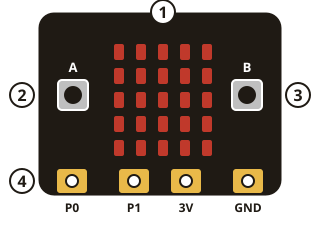

## Predict

The micro:bit's LED display can also **sense light**. It turns the light into a number from **0** (dark) to **255** (very bright). This number is called the **light level**. A **sensor** is an input that measures something in the world.

1. **LED display**: output and light sensor
2. **Button A**
3. **Button B**
4. **Pins**

Open the starter program. Find the **if** block. It **compares** the light level with the number 50.

Talk with a partner:

- What will the micro:bit show in a bright room? In a dark cupboard?
- Why is the number 50 there? What would happen with 200?
- Streetlights switch on by themselves at night. How do you think they know?

## Run

1. Tap **Run**. Open **Sensors** under the on-screen micro:bit and slide the **light** level up and down. Watch when the square appears.
2. If you have a real micro:bit, send the program to it. Cover the micro:bit with a box or your hand, then uncover it.
3. Was your prediction right?

## Investigate

1. Find the exact light level where the square switches on. Use the slider. Is it 50, 49 or 51? Why?
2. What does the **else** part do? Take the **clear screen** block out of the else part and test again. What goes wrong?
3. Find the Python line that matches the if block. What does `<` mean?
4. On a real micro:bit, measure the light level in three places: by the window, under the desk and in your bag. Use a **show number** block with the **light level** block inside it.

   | Place | Light level |
   |---|---|
   | By the window | |
   | Under the desk | |
   | In a bag | |

## Modify

1. Change 50 to 100, then to 10. When does the light switch on now?
2. Make the night light show the moon (an icon or your own LED picture) instead of the square.
3. Swap the **then** and **else** parts. What kind of machine is it now?

## Make

Design a sensor machine for a real need: a **reading light** that switches on when the room gets dark, a **sunrise alarm** that shows a sun when morning comes, or a **fridge light** that switches on when the door (a box lid) opens. Use your measured light levels to choose the threshold. Test it in the real place it would be used and improve it.

## Teacher notes

- **Timing**: 10 min predict, 15 min run and investigate, 15 min modify, 20 min make and share.
- **Big idea**: **sensor → decision → output**. The if-then-else block is the decision. The **threshold** is the switching number; choosing it is real engineering work and needs testing.
- **Real micro:bit**: the first light reading after starting can be 0; the program keeps reading, so it settles within a second. Light levels differ a lot between rooms, so learners should measure before choosing a threshold.
- **CAPS link**: matches the Grade 6 Term 1 activity "use the light sensor on the microcontroller to control an LED" (IF-THEN-ELSE, analogue input).
