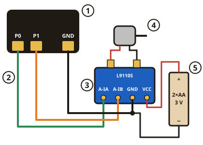

## Predict

A motor spins one way when the electricity goes through it one way, and the other way when the electricity goes through it the other way. The motor driver does this for us. The micro:bit tells it which way with two signals: pin **P0** and pin **P1**.

1. **micro:bit**
2. **Leads**: P0, P1 and GND
3. **Motor driver**
4. **Motor**
5. **Motor batteries**

Open the starter program and the Python tab. Find the `pin0` and `pin1` lines.

Talk with a partner and fill in your prediction:

   | Motor | P0 | P1 |
   |---|---|---|
   | forward | | |
   | stop | | |
   | backward | | |

What do you think happens if P0 and P1 are **both** 1?

## Run

1. Tap **Run**. Press **A**, then **B**. Watch the arrows, the **Motor** line and pins P0 and P1. Check your table.
2. **With real parts:** use the wiring from **Go and stop**. Ask an adult to check it, send the program, then put the motor batteries in.
3. Put the motor in the cart (or put a card disc with a marked edge on the shaft). Press A and B and watch which way it turns.

## Investigate

1. Swap the two **motor** wires on the driver (batteries out first). What happens now when you press A? Why?
2. Which blocks make the motor stop by itself after 1 second?
3. Press A, then quickly press B. What happens? Why does it wait?
4. In Python, both pins are written in every motor block. Why must the program set **both** pins every time?

## Modify

1. **Algorithm first.** Write these steps, then code them on button A: go forward 2 seconds, stop 1 second, go backward 2 seconds, stop.
2. Find the bug: in this algorithm the cart never comes back. Fix it in your program.

   1. Go forward
   2. Pause 1 second
   3. Go backward
   4. Stop

3. Make the cart go forward and come back to **exactly** where it started. What do you need to change? Why is it hard?

## Make

Make a **delivery cart** that carries a small item (a sweet, an eraser) to a partner and comes back. Measure the distance first, write the algorithm as numbered steps, then code it. Test, measure how far it went, and improve your pause times until it works three times in a row.

## Teacher notes

- **Timing**: 10 min predict, 15 min run, 15 min investigate, 20 min modify and make.
- **Big idea**: **two signals → three states**. P0=1, P1=0 forward; P0=0, P1=1 backward; both 0 stop. Both 1 is also stop (brake) on the L9110S, but our blocks never use it.
- **Algorithms**: writing numbered steps before coding is the CAPS habit to build. The "never comes back" bug is the missing pause after going backward: the motor stops before it has moved.
- **Coming back exactly** doesn't work with time alone (batteries, friction and the floor all change it). This is a good discussion of why real robots use **sensors**: the next lesson.
- **Electrical design check**: same circuit as Go and stop: 2 × AA (3 V) through the L9110S, micro:bit logic only, shared GND, no coin cells, no mains.
