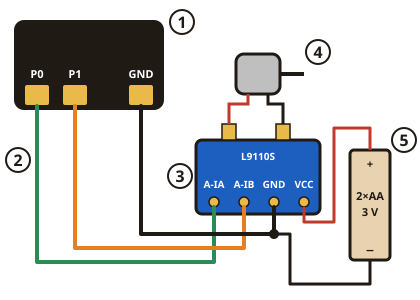

## Predict

A real **robot** does three things again and again: it **senses** (inputs), **decides** (the program), and **acts** (outputs). Your cart becomes a robot when it can react to the world by itself.

1. **micro:bit**: senses and decides
2. **Leads**
3. **Motor driver**
4. **Motor**: acts
5. **Motor batteries**

Open the starter program. It uses one **variable** called `driving`. A variable is a box with a name that remembers a value: here **1** means "I should be driving" and **0** means "stay still".

Talk with a partner:

- What happens when you press A? Does the motor start at once?
- What happens when the robot drives into a dark tunnel? When it comes out?
- What happens if somebody bumps (shakes) the robot?

## Run

1. Tap **Run** under the on-screen micro:bit. Press **A**. Open **Sensors** and move the **light** slider down and up. Then tap **Shake**.
2. **With real parts:** tape the micro:bit, its battery pack, the motor driver and the motor batteries onto the cart, and fit the motor to drive an axle. Ask an adult to check the wiring, then send the program.
3. Make a dark tunnel with a shoebox. Press A and let the robot drive towards it. Was your prediction right?

## Investigate

1. Fill in the table: what does each part of the program sense, decide or do?

   | Block | Sense, decide or act? |
   |---|---|
   | light level | |
   | if ... and ... | |
   | motor forward | |
   | on shake | |

2. Why does the robot start again when it comes out of the tunnel, but not after a shake?
3. Look at the Python tab. Find the line with `and`. What two things must both be true for the motor to go?
4. Take out the `set driving to 0` block from the shake event and test. What changes?

## Modify

1. Make the robot show a different face in the tunnel (for example, asleep) and a happy face when it drives.
2. Change the light threshold so the robot stops in the shade of a table. Measure the light level first.
3. Make the robot back away for longer after a shake, and then **carry on driving** instead of stopping.

## Make

Design a robot for a real problem, for example a **rhino patrol robot** that rests in the shade and wakes up in the sun, or a **parcel robot** that stops when it is put inside a dark box. Write what it must do as a list of **sense → decide → act** rules, code it, then test it in a real place. Change one thing at a time and record what made it better. Present your robot to the class: show the rules, the program and the robot working.

## Teacher notes

- **Timing**: 15 min predict and run on screen, 30 min build and wire (with the adult check), 15 min investigate, 30 min modify, make and present. It can be split over two lessons.
- **Big idea**: **sense → decide → act** in a loop. The forever loop checks the sensors many times a second; the variable remembers the learner's choice (the button press). CAPS introduces one variable at a time in Grade 6: `driving` is the only one.
- **Real micro:bit**: power it from its own 2 × AA pack so the robot is free to move; the motor keeps its separate 2 × AA pack through the driver. The light sensor is the LED display, so the display must face up and not be covered by tape.
- **Electrical design check**: two separate 2 × AA (3 V) packs, L9110S driver, micro:bit logic only, shared GND, no coin cells, no mains.
- **Common problems**: robot never starts (it's too dark: lower the threshold); robot stops and starts in daylight (the threshold is too close to the room's light level); shake doesn't work on the real robot (the motor shaking isn't enough: tap the cart firmly).
- **Extension**: a second motor and a second channel on the driver (B-IA, B-IB on pins P2 and P8) make a robot that can turn. Phase 3 projects build on this.
